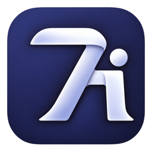
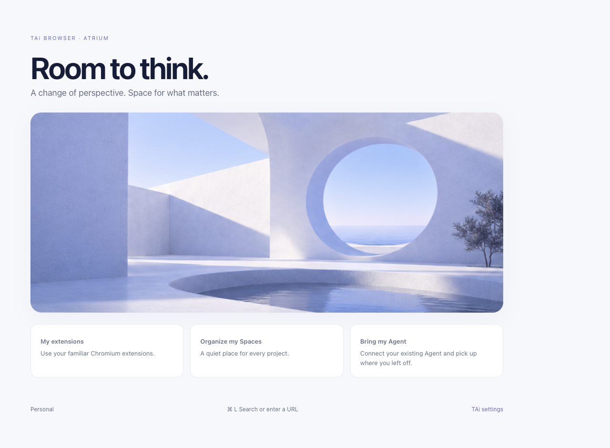

  

<h1 align="center">TAi Browser</h1>

<strong>Room to think.</strong> A Chromium browser built around Spaces and the agents you choose.

  <a href="README.zh-CN.md">简体中文</a> ·
  <a href="#get-tai">Get TAi</a> ·
  <a href="docs/GETTING-STARTED.md">Getting started</a> ·
  <a href="CONTRIBUTING.md">Contribute</a>

Early development · macOS Apple Silicon · BSD-3-Clause

A current development build · Atrium new-tab page

## A place for your work

TAi combines a native workspace sidebar with Chromium's browsing engine and extension ecosystem. Organize the web into Spaces, keep everyday sites close, and let an external agent work within an explicitly authorized scope.

### Spaces that stay organized

A native sidebar brings folders, pinned pages, temporary tabs and favorites together. Give each Space an emoji and a color, swipe between Spaces, and keep favorites and the Space header visible while scrolling.

### The browser tools you already use

Keep Chromium extensions, downloads, passwords, site permissions and developer tools. TAi adds configurable shortcuts, an English and Simplified Chinese interface, and a macOS global search palette with **⌥⌘N** while a browser window is open. The welcome card imports Chrome and Safari bookmark exports and Arc saved pages. Password CSV import opens Chromium’s password manager.

### Bring your own agent

TAi connects to ChatGPT, Claude Code, Pi and other MCP clients. Authorize a Space to let an agent read pages. Opening pages, clicking, typing and taking screenshots are optional permissions. The toolbar shows which pages the agent accesses, and selecting one opens its tab. You can choose to reconnect automatically when the browser restores the same window. [Connect an agent](docs/AGENT-CONNECTION.md)

### A quieter interface

**Atrium · 光庭** pairs open architectural spaces and natural light with a blue-violet palette. Choose Atrium or Pride and set light, dark or system appearance independently.

## Get TAi

Alpha 1 targets Apple Silicon Macs. The DMG uses an ad hoc signature and has not been notarized by Apple. macOS may require per-app approval on first launch. See the [installation guide](docs/GETTING-STARTED.md#downloads) and [GitHub Releases](https://github.com/EuanTop/tai-browser/releases).

[Download and installation guide](docs/GETTING-STARTED.md) · [Build from source](CONTRIBUTING.md)

Internal standalone builds bundle the browser and Agent runtime. Intel Mac, Windows and Linux installers are outside the current build target.

## What's next

- Refine everyday sidebar, tab, shortcut and Space interactions.
- Expand browser migration coverage and complete the multi-Profile workflow.
- Validate more real agent tasks and user/agent parallel browsing.

For current limitations, see [Getting started](docs/GETTING-STARTED.md#current-limits). Detailed engineering evidence lives in the [acceptance record](docs/PRODUCT-ACCEPTANCE.md).

## Build and contribute

TAi's source is organized as a browser UI and integration layer over a [pinned Chromium revision](chromium.lock.json). This repository contains TAi's code, not the entire Chromium checkout. Blink, V8, the networking engine and the sandbox stay upstream.

| Work on | Start here |
| --- | --- |
| Native browser UI | [`src/chromium/`](src/chromium/) — C++ and Objective-C++ |
| Spaces and organization | [`src/sidebar/`](src/sidebar/) — C++ models |
| Settings, home and panels | [`src/chromium/webui/`](src/chromium/webui/) — HTML, CSS and JavaScript |
| Agent browser tools | [`modules/agent-tools/`](modules/agent-tools/) — JavaScript and MCP |
| Build and verification | [`tools/`](tools/) · [Contributing](CONTRIBUTING.md) |

Have a reproducible bug or an interaction idea? [Open an issue](https://github.com/EuanTop/tai-browser/issues). For security reports, follow the [private reporting instructions](SECURITY.md). For code changes, follow the [contribution guide](CONTRIBUTING.md) and [current product focus](docs/PRODUCT-FOCUS.md). Maintainers can find the distribution process in the [release guide](docs/REPOSITORY-AND-RELEASE.md).

## License and acknowledgements

TAi-authored work is licensed under [BSD-3-Clause](LICENSE). Built on [Chromium](https://www.chromium.org/); third-party code retains its original licenses and notices. See [NOTICE](NOTICE). Design and engineering references are recorded in the [research notes](research/).

Arc’s sidebar workflow was a design reference for TAi.
