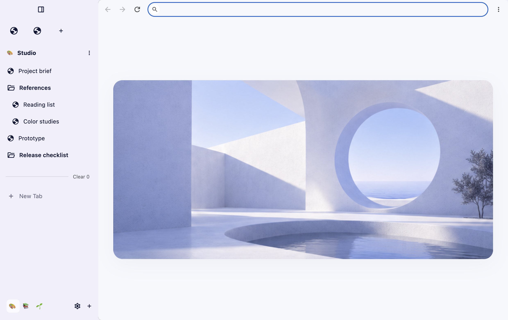

<h1 align="center">TAi Browser</h1>

A macOS browser for working in Spaces and bringing the agent you already use.

  <a href="https://github.com/EuanTop/tai-browser/releases/tag/v0.1.0-alpha.1"><strong>Download Alpha 1 for Apple Silicon</strong></a> ·
  <a href="docs/GETTING-STARTED.md">Getting started</a> ·
  <a href="README.zh-CN.md">简体中文</a>

TAi Browser development build on macOS, with sample browsing data.

## What you can do with TAi

- **Keep each project in its own Space.** Pin pages you return to, organize them in folders, and clear temporary tabs when you're done. Swipe across the sidebar to switch Spaces.
- **Give your agent a Space to work in.** Connect ChatGPT, Claude Code, Pi, or another compatible MCP client. Choose a Space and grant interaction and screenshot permissions separately. TAi’s toolbar shows which pages an agent is accessing. [Connect an agent](docs/AGENT-CONNECTION.md)
- **Make the browser yours.** Choose Atrium or Pride, set individual Space colors, and use light, dark, or system appearance. TAi is built on Chromium and supports its extensions, password manager, and developer tools.

## Try it in a minute

1. **Install.** Open the [Alpha 1 DMG](https://github.com/EuanTop/tai-browser/releases/tag/v0.1.0-alpha.1) and drag TAi Browser into Applications. It requires macOS 13 or later and Apple Silicon. This alpha is ad hoc signed and macOS may ask you to approve the first launch. [Installation steps](docs/GETTING-STARTED.md#downloads)
2. **Make a Space.** Use **+** at the bottom of the sidebar. Open a page and use its tab menu to pin it. Use **Clear** in the sidebar when you’re done with temporary tabs.
3. **Bring your saved pages.** The welcome card accepts Chrome and Safari bookmark exports and saved pages from Arc. Password CSV import opens Chromium’s password manager. Website sign-in sessions stay in your original browser. [Migration guide](docs/MIGRATION.md)

Alpha 1 uses manual updates. [Release notes and checksums](https://github.com/EuanTop/tai-browser/releases/tag/v0.1.0-alpha.1) · [Keyboard shortcuts and default browser setup](docs/GETTING-STARTED.md#start-browsing)

## Feedback and contributions

[Report a bug or request a feature](https://github.com/EuanTop/tai-browser/issues) · [Build from source and contribute](CONTRIBUTING.md) · [Report a security issue privately](SECURITY.md)

TAi-authored work is licensed under [BSD-3-Clause](LICENSE). [Chromium and third-party notices](NOTICE) · [Design and engineering references](research/)
