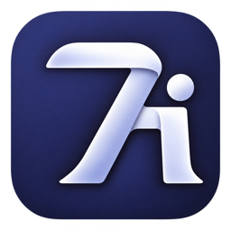
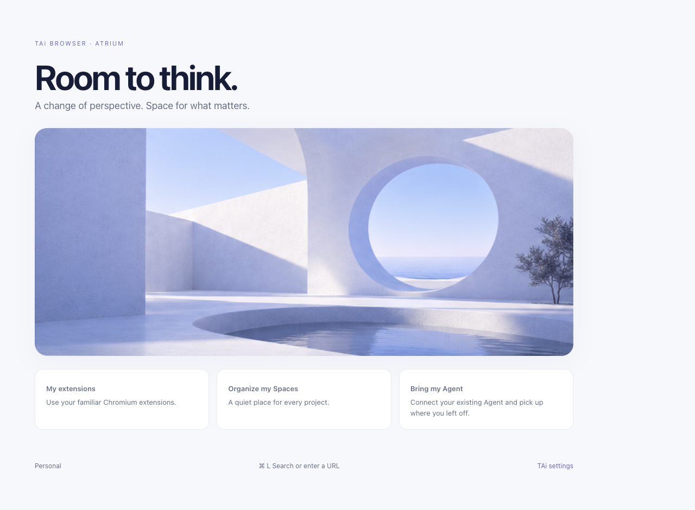

  

<h1 align="center">TAi Browser</h1>

<strong>为思考留出空间。</strong> 围绕 Space 和你选择的 Agent 构建的 Chromium 浏览器。

  <a href="README.md">English</a> ·
  <a href="#获取-tai">获取 TAi</a> ·
  <a href="docs/GETTING-STARTED.zh-CN.md">使用指南</a> ·
  <a href="CONTRIBUTING.md">参与贡献</a>

早期开发 · macOS Apple Silicon · BSD-3-Clause

当前开发版本的新标签页 · 光庭标准主题

## 给你的工作留一处空间

TAi 将原生工作区侧栏与 Chromium 的网页内核、扩展生态结合起来。用 Space 区分不同事务，把常用网站放在手边，让外部 Agent 在你明确授权的范围内使用浏览器。

### 让页面各归其位

原生侧栏整合文件夹、固定页面、临时标签和常用网站。为每个 Space 选择 emoji 和颜色。滑动切换 Space，纵向滚动时常用网站和 Space 标题保持置顶。

### 继续使用熟悉的浏览器工具

保留 Chromium 扩展、下载、密码、网站权限和开发者工具。TAi 提供可自定义的快捷键、英文与简体中文界面。浏览器窗口打开时，使用 **⌥⌘N** 唤起全局搜索。欢迎卡片可以导入 Chrome、Safari 导出的书签和 Arc 保存的网页。密码 CSV 通过 Chromium 密码管理器导入。

### 带上你自己的 Agent

TAi 通过 MCP 连接 ChatGPT、Claude Code、Pi 和其他客户端。授权后，Agent 可以读取指定 Space 的页面。可以额外授权打开网页、点击和输入，也可以单独授权截图。工具栏显示 Agent 正在访问的页面，选中即可跳到原标签页。还可以启用自动连接，在浏览器恢复原窗口时续用授权。[Agent 连接指南](docs/AGENT-CONNECTION.md)

### 安静、开阔的界面

**光庭 · Atrium** 用开阔的建筑空间、自然光影和蓝紫色组织界面。Atrium 和 Pride 主题都可以单独选择浅色、深色或跟随系统。

## 获取 TAi

Alpha 1 面向 Apple Silicon Mac。DMG 使用临时签名，尚未经过 Apple 公证。macOS 首次打开时可能需要对应用单独授权。下载及安装方法见[使用指南](docs/GETTING-STARTED.zh-CN.md#下载)和 [GitHub Releases](https://github.com/EuanTop/tai-browser/releases)。

[下载与安装指南](docs/GETTING-STARTED.zh-CN.md) · [从源码构建](CONTRIBUTING.md)

本机独立测试包已捆绑浏览器和 Agent 运行时。当前构建目标为 Apple Silicon Mac。

## 接下来的重点

- 打磨侧栏、标签、快捷键和 Space 的日常交互。
- 扩展浏览器迁移的覆盖范围，完善多 Profile 工作流。
- 验证更多真实 Agent 任务和用户/Agent 并行浏览。

当前使用边界见[使用指南](docs/GETTING-STARTED.zh-CN.md#当前边界)；详细工程证据保留在[验收记录](docs/PRODUCT-ACCEPTANCE.md)中。

## 开发与贡献

TAi 以浏览器界面与接入层的形式，构建在[固定版本的 Chromium](chromium.lock.json)之上。本仓库保存 TAi 自有代码，不包含整份 Chromium 检出；Blink、V8、网络引擎与沙箱沿用上游实现。

| 想参与的方向 | 从这里开始 |
| --- | --- |
| 原生浏览器 UI | [`src/chromium/`](src/chromium/) — C++、Objective-C++ |
| Space 与页面组织 | [`src/sidebar/`](src/sidebar/) — C++ 模型 |
| 设置、首页与面板 | [`src/chromium/webui/`](src/chromium/webui/) — HTML、CSS、JavaScript |
| Agent 浏览器工具 | [`modules/agent-tools/`](modules/agent-tools/) — JavaScript、MCP |
| 构建与验证 | [`tools/`](tools/) · [贡献指南](CONTRIBUTING.md) |

发现可复现的问题，或有具体的交互建议？欢迎[提交 Issue](https://github.com/EuanTop/tai-browser/issues)。安全问题请通过[私下报告渠道](SECURITY.md)提交。代码贡献请先阅读[贡献指南](CONTRIBUTING.md)和[当前产品方向](docs/PRODUCT-FOCUS.md)。维护者的发包流程见[发布指南](docs/REPOSITORY-AND-RELEASE.md)。

## 许可与致谢

TAi 自有内容采用 [BSD-3-Clause](LICENSE)。项目基于 [Chromium](https://www.chromium.org/)，第三方代码保留原有许可和声明，见 [NOTICE](NOTICE)。设计与工程参考保留在[研究记录](research/)中。

Arc 的侧栏操作方式为 TAi 提供了设计参考。
