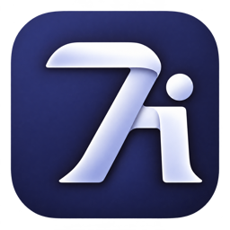
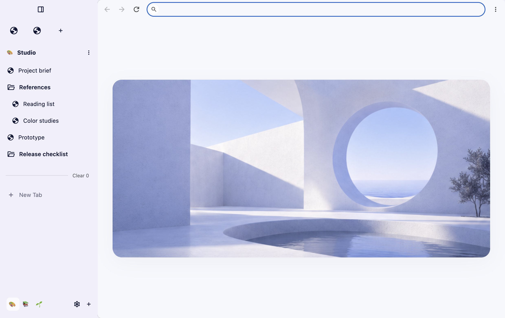

<h1 align="center">TAi Browser</h1>

一个以 Space 组织网页、能连接你常用 Agent 的 macOS 浏览器。

  <a href="https://github.com/EuanTop/tai-browser/releases/tag/v0.1.0-alpha.1"><strong>下载 Apple Silicon 版 Alpha 1</strong></a> ·
  <a href="docs/GETTING-STARTED.zh-CN.md">开始使用</a> ·
  <a href="README.md">English</a>

macOS 上运行的 TAi Browser 开发版，使用示例浏览资料。

## 用 TAi 做什么

- **每个项目都有自己的 Space。** 固定常用网页，用文件夹整理，随时一键清理临时标签。在侧栏横滑可切换 Space。
- **让 Agent 在指定 Space 工作。** 连接 ChatGPT、Claude Code、Pi 或其他兼容的 MCP 客户端。选择授权的 Space，分别决定是否允许操作和截图。浏览器顶部会提示 Agent 正在访问哪些页面。[连接指南](docs/AGENT-CONNECTION.md)
- **按自己的习惯设置浏览器。** 在光庭和瞳光之间切换，为不同 Space 选颜色，并选择浅色、深色或跟随系统。TAi 基于 Chromium，支持 Chromium 扩展、密码管理器和开发者工具。

## 一分钟上手

1. **安装。** 打开 [Alpha 1 DMG](https://github.com/EuanTop/tai-browser/releases/tag/v0.1.0-alpha.1)，把 TAi Browser 拖入「应用程序」。需要 Apple Silicon 和 macOS 13 或更新版本。这一版使用临时签名，macOS 可能要求你批准首次打开。[安装步骤](docs/GETTING-STARTED.zh-CN.md#下载)
2. **创建 Space。** 点侧栏底部的 **+**。打开网页后，可通过标签页菜单固定网页。浏览结束后，点侧栏的**清理**关闭临时标签。
3. **迁移常用网页。** 欢迎卡片可导入 Chrome 和 Safari 的书签导出，以及 Arc 的已保存网页。密码 CSV 通过 Chromium 的密码管理器导入。站点登录状态保留在原浏览器里。[迁移指南](docs/MIGRATION.md)

Alpha 1 需要手动更新。[发行说明与校验值](https://github.com/EuanTop/tai-browser/releases/tag/v0.1.0-alpha.1) · [键盘快捷键与默认浏览器设置](docs/GETTING-STARTED.zh-CN.md#开始浏览)

## 反馈与贡献

[反馈 Bug 或提出功能建议](https://github.com/EuanTop/tai-browser/issues) · [从源码构建和参与贡献](CONTRIBUTING.md) · [私下报告安全问题](SECURITY.md)

TAi 自有代码采用 [BSD-3-Clause](LICENSE)。[Chromium 与第三方声明](NOTICE) · [设计与工程参考](research/)
